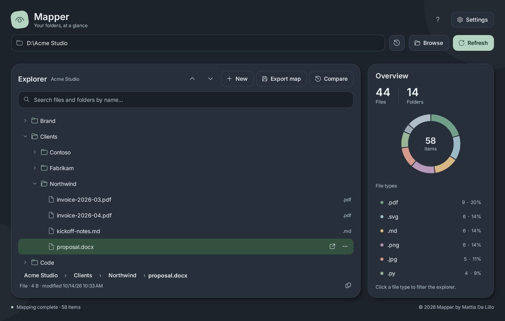
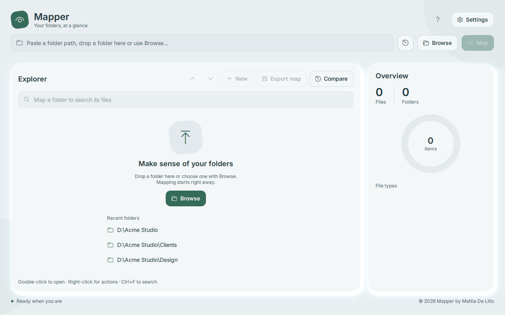
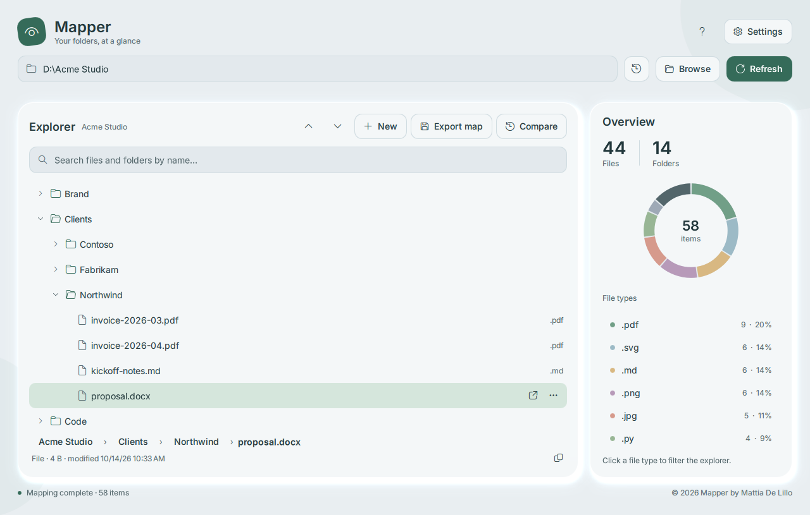
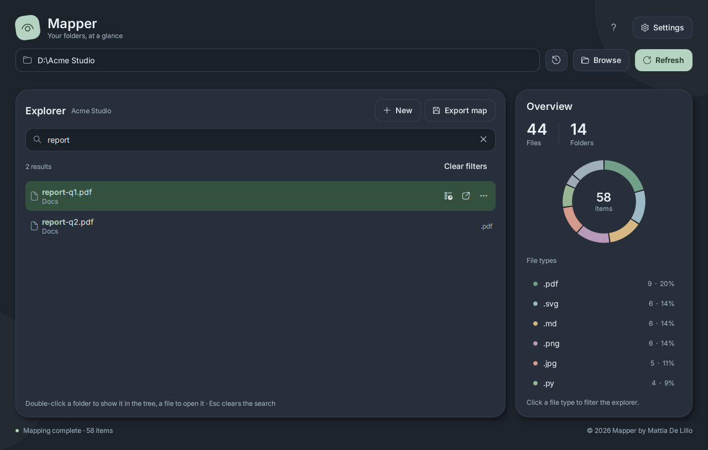
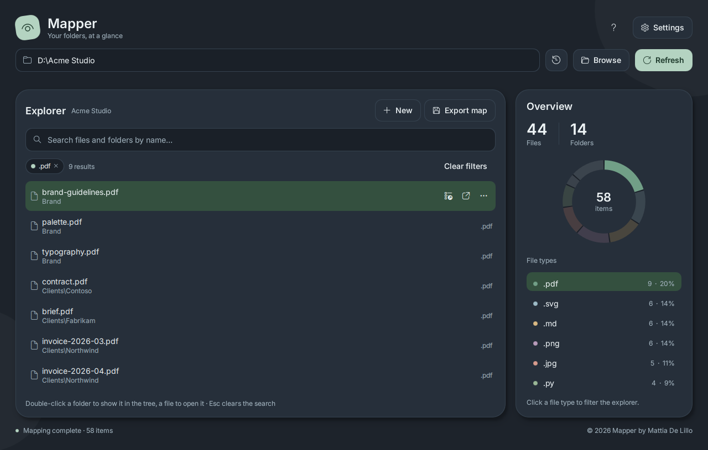
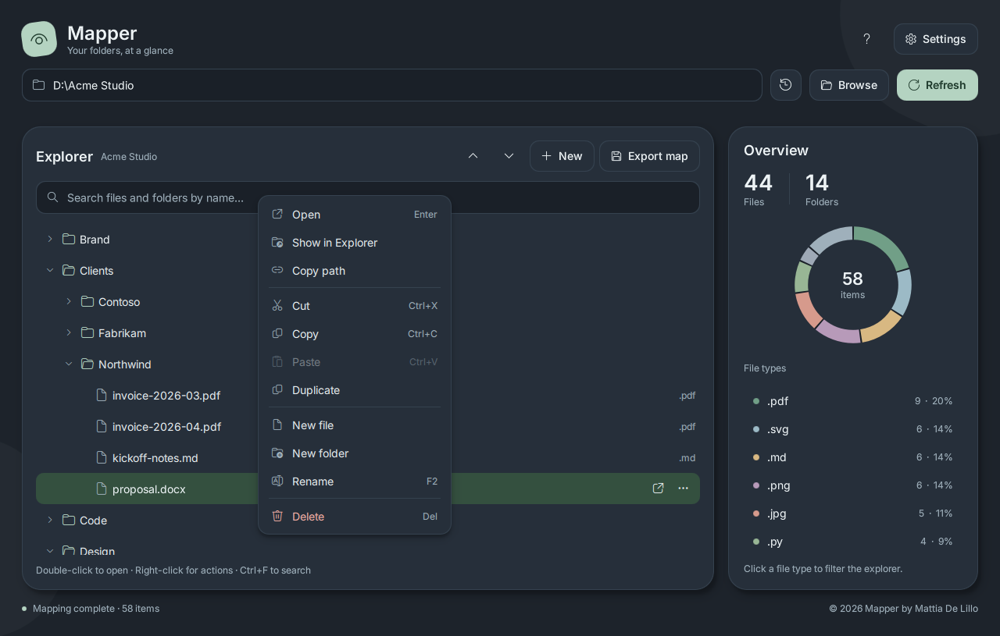
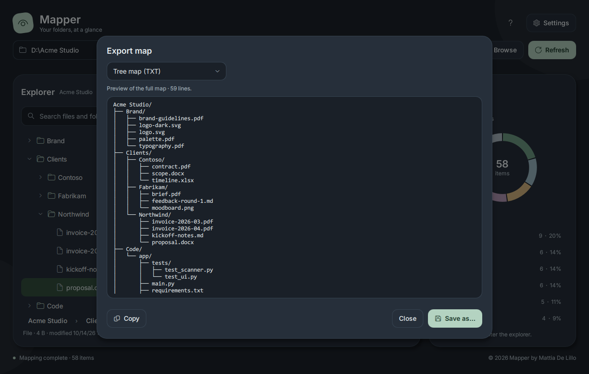
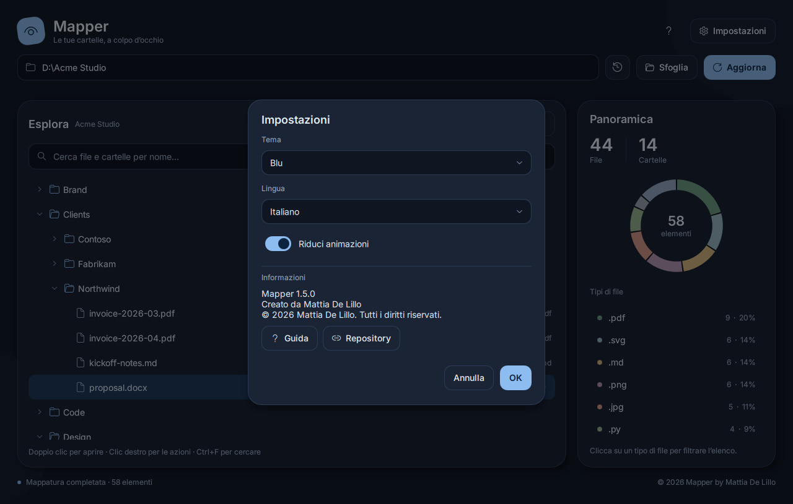

# Mapper 1.5

**English** · [Italiano](README.it.md)

A Windows desktop app for exploring folders, finding files and exporting Unicode tree maps.
Python handles the filesystem; **PySide6 + Qt Quick/QML** renders the interface.



## Screenshots

| | |
| --- | --- |
|  |  |
| **Start** — browse, drop a folder or reopen a recent one | **Explorer** — expandable tree and file-type overview |
|  |  |
| **Search** — matches highlighted, with each item's location | **Filter by type** — click the chart or legend |
|  |  |
| **Actions** — right-click or ⋯ for file operations | **Export map** — preview, copy or save as text |
|  | |
| **Settings** — five themes and five languages, live preview | |

Screenshots are generated from a demo folder with `python build/make_screenshots.py`.

## Get started

Mapper runs on **Windows 10 and 11**.

### Option 1 — Download the app

When a release is available, download `Mapper.exe` from the
[Releases page](https://github.com/SoulFlaZ3R/mapper/releases) and double-click it.
No installation is needed: it is a single portable file. Each release also lists a SHA-256
checksum and a GitHub build attestation, so you can check the file was built from this code.

Windows SmartScreen may warn about an unknown publisher because the app is not code-signed yet:
choose **More info → Run anyway**.

### Option 2 — Run from the source code

1. Install **Python 3.12 or newer** from [python.org](https://www.python.org/downloads/windows/).
   During setup, tick **"Add python.exe to PATH"**.
2. Get the code: click **Code → Download ZIP** on this page and extract it, or use Git:

   ```powershell
   git clone https://github.com/SoulFlaZ3R/mapper.git
   cd mapper
   ```

3. Open PowerShell in the project folder (in Explorer: **Shift + right-click → Open PowerShell window here**)
   and create an isolated environment:

   ```powershell
   py -m venv .venv
   ```

4. Install the dependencies (PySide6, a few hundred MB) and start Mapper:

   ```powershell
   .venv\Scripts\python -m pip install -r requirements.txt
   .venv\Scripts\python src/mapper.py
   ```

Next time, only the last command is needed.

Preferences and recent folders stay on your computer. The app saves them in the hidden folder
`%APPDATA%\Mapper`, so no file appears next to `Mapper.exe` (for example on your Desktop).
To carry them on a USB stick, create an empty `config.json` next to `Mapper.exe`: the app then uses that file.
When run from source they are saved in `src/config.json`.

## Features

- **Map in one step**: Browse, drag a folder onto the window, paste a path or pick a recent folder; mapping starts immediately
- Virtualized tree with expand/collapse, expand all/collapse all and full keyboard navigation; open folders stay open after refreshes and file actions
- **Search as you type** across the whole map, with highlighted matches and the location of each result; *Show in tree* opens the parent folders and selects the item
- Interactive donut chart and complete, scrollable legend; click a file type to filter, click again (or the chip) to clear
- Background scanning with real progress and cancellation
- Right-click (or ⋯) actions: open, show in Explorer, copy path, cut/copy/paste, duplicate, new file/folder, rename, delete
- Delete moves items to the **Recycle Bin**; copies never overwrite (`name - copy`, `name - copy (2)` …); names are validated before confirming
- **Export map**: preview, copy to the clipboard or save as UTF-8 text; the export is exactly the mapped tree
- Five themes (light, dark, blue, red, system) and five languages (Italian, English, German, French, Spanish), with live preview in Settings
- One consistent style for buttons, fields, menus, dialogs, tooltips and selectors; optional reduced motion
- Portable executable, no installation; preferences in `%APPDATA%\Mapper`, or next to the exe for USB use

Search uses the latest map. Press F5 to refresh changes made by other applications.
Inaccessible folders are skipped; symbolic links and NTFS junctions are not traversed.
The window cannot close while a copy/move/delete is still running.

## Keyboard shortcuts

| Shortcut | Action |
| --- | --- |
| Ctrl+O | Choose a folder |
| Ctrl+L | Edit the folder path |
| F5 | Refresh the map |
| Ctrl+F | Search |
| Ctrl+E | Export map (preview, copy, save) |
| Ctrl+S | Save the map as… |
| Escape | Cancel mapping/export, clear the search |
| ↑ ↓ ← → | Move, expand and collapse in the tree |
| Enter | Open a file, expand a folder (in search: show it in the tree) |
| F2 | Rename |
| Ctrl+C / Ctrl+X / Ctrl+V | Copy, cut, paste |
| Delete | Move to the Recycle Bin (after confirmation) |
| Menu / Shift+F10 | Actions for the selected item |

## Tests and build

```powershell
python -m unittest discover -s tests -v
python tests/smoke_ui.py
pip install pyinstaller
build/build.bat
```

Unit tests cover the scanner (tree lines, progress, cancellation, drive roots, junctions),
incremental tree updates, search and *Show in tree*, export, file actions (Recycle Bin,
unique copy names, case-only renames, overwrite protection), validation, preferences, recent
folders and translation completeness. The UI smoke test loads the real QML, opens every
dialog and menu, switches themes, searches, filters, exports, checks list virtualization and
writes light/dark/compact previews under `build/`.

`build/mapper.spec` is the single build definition used by `build.bat` and GitHub Actions.
It keeps only the Qt modules Mapper uses (QtQuick, Controls, Dialogs, Effects, Layouts), which
drops WebEngine, 3D, Charts, Multimedia and PDF (171 MB → about 47 MB), disables UPX and embeds
Windows version information.

Build output: `portable/Mapper.exe`. Test packaged startup with:

```powershell
portable/Mapper.exe --smoke-test
```

The Windows build explicitly selects the system ICU library required by Qt.
This avoids a conflicting `icuuc.dll` from some bundled Python runtimes.

## Structure

```text
src/mapper.py       Qt application and QML launcher
src/backend.py      List model, background jobs, filesystem actions and preferences
src/scanner.py      Scanner: one traversal for the explorer index and the tree map
src/qml/Main.qml    Interface, shared components, themes and motion
src/Languages/      Five translation dictionaries (same keys)
docs/screenshots/   README images (build/make_screenshots.py)
tests/              Unit tests and real QML smoke test
build/              Build script, icon and Windows manifest
portable/           Windows executable and usage notes
```

## License

Mapper source: [MIT](LICENSE), Mattia De Lillo.
Bundled Inter fonts: SIL Open Font License 1.1, © The Inter Project Authors ([src/fonts/OFL.txt](src/fonts/OFL.txt)).
PySide6/Qt have their own licenses; see [Qt licensing](https://doc.qt.io/qt-6/licensing.html)
when redistributing the bundled runtime. Executables are never committed: tagged pushes (`v*`)
test, build and smoke-test the exe on GitHub Actions, attach a build-provenance attestation and
a SHA-256 checksum, and publish them as a release. Code signing (SignPath) is prepared but disabled.
A manual run (**Actions → Build and Sign → Run workflow**) only tests, builds and smoke-tests the exe,
then discards it: nothing is uploaded or published.

Verify a downloaded release with `gh attestation verify Mapper.exe --repo SoulFlaZ3R/mapper`.
